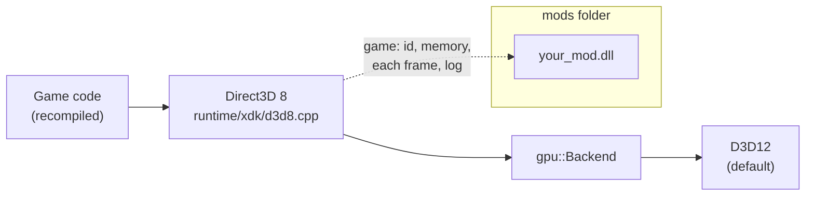
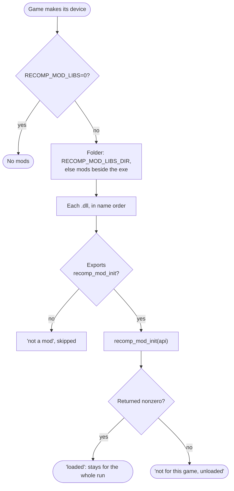
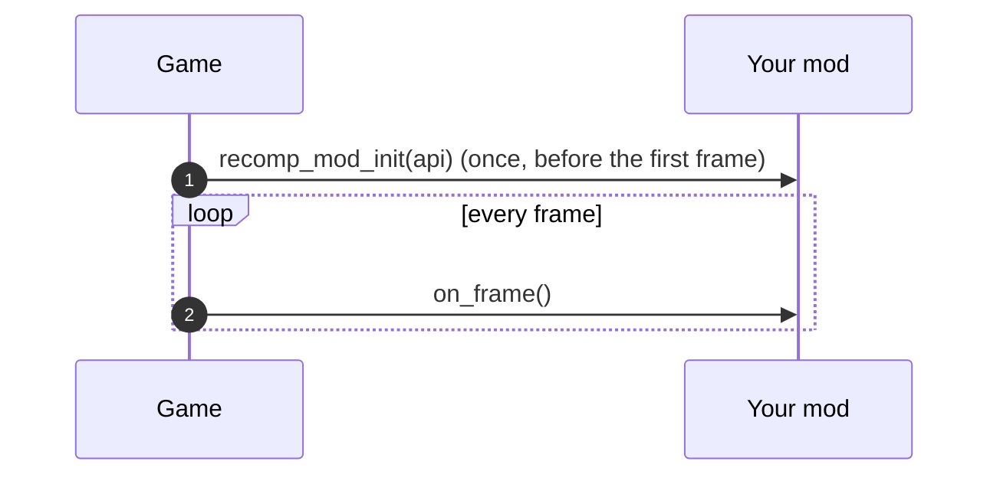

# Mods

A recompiled game is a native program, so a player can change it the way PC games have long been changed: by dropping
a library beside it. The SDK gives such libraries one small, versioned C contract,
[`runtime/mods/recomp_mod.h`](../runtime/mods/recomp_mod.h), so a change to a game can live outside the game's build:
the port stays the port, and a mod is something a player chooses to add.

The version 5 contract retains its established layout for compatibility. The D3D9-specific fields are reserved and
no-op in this SDK; the supported API covers title information, guest memory, per-frame callbacks, and logging.
This page explains how to build and load a mod.

**Contents:** [At a glance](#at-a-glance) · [Where a mod sits](#where-a-mod-sits) · [Your first mod](#your-first-mod) ·
[Loading](#loading) · [A frame](#a-frame) · [API reference](#api-reference) · [Versions](#versions) ·
[Where a change belongs](#where-a-change-belongs) · [Troubleshooting](#troubleshooting)

## At a glance

| You want to... | Use |
| --- | --- |
| Read the game's state (score, health, camera) each frame | `guest_pointer` + `on_frame` |
| Identify the running game | `title_id`, `title_name` |
| Write a line in the game's log | `log` |

The API does not name a game or a tool: a mod for one game checks the game it is loaded into and unloads itself from
any other. Texture packs are not mods; they go in `textures\replacement\` beside the exe.

## Where a mod sits

**Figure 1.** The game's code draws through the SDK's Direct3D 8 runtime and renderer. A mod is a separate library
beside the game; it never links against the SDK.



The D3D9-specific API fields remain in the version 5 structure to preserve ABI offsets, but this SDK does not provide
their renderer behavior.

## Your first mod

**Figure 2.** What goes where.

```text
<game folder>/
├── Game.exe                 the port
└── mods/
    └── hello_mod.dll        your mod
```

1. **Copy the header.** `recomp_mod.h` stands alone (it includes only `<stddef.h>` and `<stdint.h>`). Put a copy beside
   your source; you do not build against the SDK.
2. **Write `recomp_mod_init`.** Check the version and the game, register the hooks you want, return 1 to stay loaded.

   ```c
   #include "recomp_mod.h"

   static const RecompModApi *g_api;
   static unsigned g_frames;

   static void each_frame(void *user)
   {
       (void)user;
       if (++g_frames % 600 == 0)
           g_api->log("hello: ten more seconds at 60 fps");
       /* read the game's state through g_api->guest_pointer(...) */
   }

   __declspec(dllexport) int recomp_mod_init(const RecompModApi *api)
   {
        if (api->version < RECOMP_MOD_API_VERSION || api->title_id() != 0x4553000Au)
           return 0;                       /* not ours: unload */
       g_api = api;
       api->on_frame(each_frame, NULL);
       api->log("hello: loaded");
       return 1;
   }
   ```

3. **Build it as a 64 bit DLL**, like the game: `clang -shared -O2 hello_mod.c -o hello_mod.dll`, or with MSVC
   `cl /LD /O2 hello_mod.c /Fe:hello_mod.dll`.
4. **Drop it in `mods` and start the game.** The log says what happened:

   ```text
   [MOD] hello: loaded
   [MOD] hello_mod.dll: loaded
   [MOD] 1 of 1 in <game folder>\mods loaded
   ```

## Loading

**Figure 3.** Which libraries are mods. The loader runs once before the game's first frame.



| Setting | Effect |
| --- | --- |
| *(nothing)* | every mod in `mods` beside the exe |
| `RECOMP_MOD_LIBS=0` | no mods at all, for comparing with and without |
| `RECOMP_MOD_LIBS_DIR=<folder>` | mods from that folder instead |

Up to 16 mods load from one folder, in name order.

## A frame

**Figure 4.** A mod's generic callbacks.



`on_frame` runs on the game's thread after the game submits each present.

## API reference

The generic entries work in this SDK. The D3D9-specific entries are retained in their version 5 positions for ABI
compatibility, but are no-op or return 0 because this SDK has no D3D9 backend.

The generic API entries are:

| Entry | Behavior |
| --- | --- |
| `title_id`, `title_name` | Return the running XBE's title ID and UTF-8 certificate name. |
| `guest_pointer` | Return a host pointer for a guest virtual address. |
| `on_frame` | Register a callback after each game present; up to 16 across mods. |
| `log` | Write a line to the game log with a `[MOD]` prefix. |
| `vertex_constants` | Reserved v5 entry; returns 0 without a renderer draw hook. |
| D3D9-specific fields | Reserved in their original v5 positions; callbacks are no-op or return 0. |
| `replaying`, capture/replay entries | `replaying` returns 0; capture/replay callbacks are accepted but never called. |

`recomp_mod_init` and `on_frame` callbacks run on the game's thread.

## Versions

Fields are only ever added at the end. A mod checks `api->size` before using one newer than it knows;
`RECOMP_MOD_HAS(api, field)` does that check. `api->version` names the newest set (5 here). The D3D9-specific entries
remain reserved at their original offsets.

## Where a change belongs

| A change that... | Goes in |
| --- | --- |
| any game would want (a renderer feature, a new hook) | this SDK, and the contract in both toolkits |
| is a fact about one game (its registers, its fixes) | that game's port |
| exists for one tool or one look (RTX Remix's hints, a style) | a mod |

## Troubleshooting

| The log shows | What it means |
| --- | --- |
| no `[MOD]` lines | no `mods` folder beside the exe, or `RECOMP_MOD_LIBS=0` |
| `could not load (126)` | a DLL the mod needs is missing beside it |
| `could not load (193)` | a 32 bit DLL: build it 64 bit |
| `no recomp_mod_init, not a mod` | the function is not exported (`__declspec(dllexport)`, C linkage) |
| `not for this game, unloaded` | its init returned 0: another game, or a toolkit too old for it |

## Keeping this guide current

This page is part of the contract. A change to `recomp_mod.h` or `runtime/mods/mods.cpp` updates the generic API
description in the same commit.
