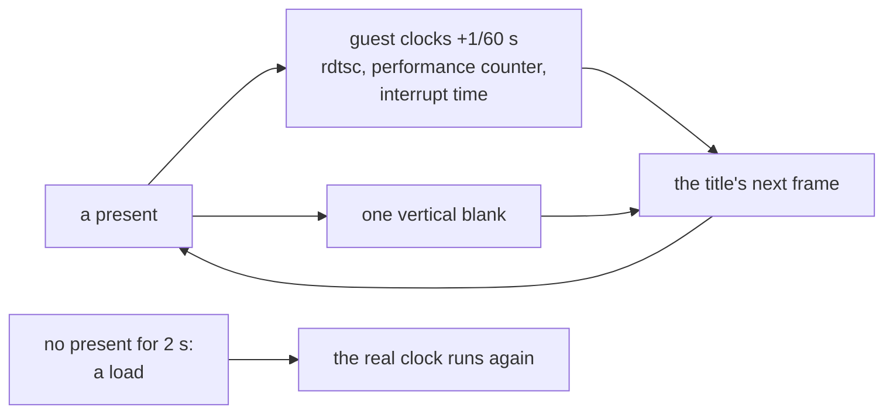

# Test runs

Driving a game with nobody at it, to compare renderers or check a change. All of it is `runtime/core/testdrive`, and
all of it is off unless a variable below is set.

| Variable | Does |
| --- | --- |
| `XBE_PAD_SCRIPT` | A file of `frame BUTTONS [frames held]` lines, `#` for a comment. Frames count presents; held 8 by default |
| `XBE_PAD_CAPTURE` | A file to record pad 0's guest-visible changes into, in the same format; one line per button/axis change |
| `XBE_TEST_DIR` | The run's folder. Read every other frame: a file `cmd` is pressed once and removed, a file `snap` saves the next frame and is removed |
| `XBE_LOCKSTEP` | One vertical blank for each present, and the guest's clocks kept by presents |
| `XBE_BACKGROUND` | The window opens off screen and never takes the focus |
| `XBE_MUTE` | Everything runs, nothing is heard |

`BUTTONS` are joined by `+`: `UP DOWN LEFT RIGHT START BACK A B X Y BLACK WHITE LT RT L3 R3`, `LS LSD LSL LSR` for the
left stick, `RS RSD RSL RSR` for the right, `KEY:<name or #vk>` for a key the game reads itself. A name may carry
`=<value>` for a partial analog value (0-255 for `A B X Y BLACK WHITE LT RT`, a 0-32767 magnitude for a stick
direction); no value means full deflection. A press of `N` frames is active at frames `at .. at+N-1`.

`XBE_PAD_CAPTURE=<file>` writes a script of a real session: pad 0's state after the game's own pad hook, one line per
change, using the same presented-frame counter and names. The result replays with `XBE_PAD_SCRIPT` here and with
`SCRIPT` in the headless harness (`sdk/harness/README.md`). With the variable unset there is one branch per poll.
Replay is additive over a connected pad and the key bindings, so unplug controllers for an exact reproduction.

## Lockstep

A renderer that presents slower gets fewer frames in the same time, so two runs of one script reach different game
frames, and a script timed by frames lands somewhere else. Under `XBE_LOCKSTEP` the guest's time is presents, not the
wall clock:

**Figure 1.** What a present moves under lockstep.

The clocks never go backwards. Between presents they run for at most 1/60 s and then hold, so a title that measures a
slow frame sees a normal one. A load presents nothing, so after 2 s the clocks run in real time and vertical blanks
come by themselves, or a title waiting on either would wait for ever.

Audio and anything else on the host's own threads stays on the wall clock. Lockstep makes runs reach the same frames, not
the same bytes: random numbers, threads and anything seeded from the time at boot still differ.

## Frames

`testdrive::SnapAs(name)` saves the next presented frame as `<name>.bmp` in `XBE_TEST_DIR`, top down from the back
buffer before it is presented. A game's own test route calls it. The file
`snap` does the same with a running number.
